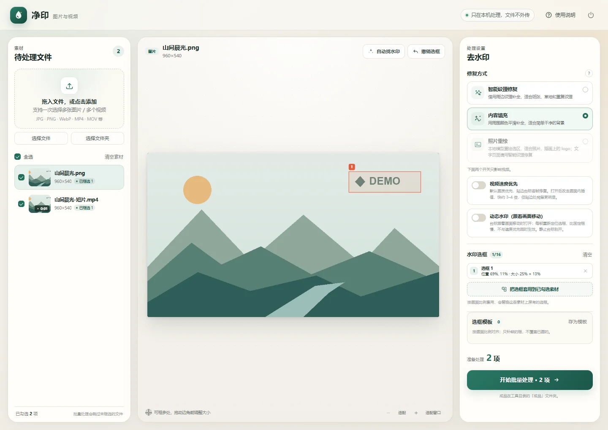

# 净印 · 批量去水印工具

在 Windows 上批量处理图片和视频水印。安装后通过浏览器操作，素材和成品留在本机。请选择自己拥有或获准处理的素材。



自制样张使用「内容填充」处理。左侧为原图，右侧为实际导出的成品。


## 能做什么

- **格式**：图片 jpg / png / webp / bmp / tiff；视频 mp4 / mov / webm / mkv / avi。
- **规模**：一次最多 120 个文件；每份素材最多 16 个选框，第 17 个**明确报错**，不会静默丢框。
- **自动识别**：自己找水印位置；找不准时另给不超过 6 处低对比「疑似」虚线框，点「采纳」才变成正式选框。
- **三种修复方式**：智能纹理修复（默认）／内容填充／照片重绘（本地 LaMa 模型，需另外下载，见下）。
- **视频**：速度优先 / 画质优先开关（默认画质优先）、动态水印逐帧跟踪、静止水印时序掩膜修复，成品保留可用的音轨与文字字幕。
- **可中断**：跑到一半能停止，已完成的成品照样保留并可打包；停止后界面逐份列出「还没做完的文件」，并能**继续处理剩下的 N 项**（已完成的不重跑、不散进第二个文件夹）。
- **单份重跑**：结果卡片上的「重跑这份」会用**当前画面上这份素材的选框**和当前档位重做那一条，覆盖同一个成品文件，同批其他份数逐字节不动；重跑先写临时文件、成功才替换，失败或中途停止时原来那份还在，本批的 ZIP 缓存也会作废重打。
- **选框模板**：同一版式的素材框一次就够，一键套用全批（最多 10 个模板，只存本浏览器的 localStorage）。
- **工作区持久**：素材与手画的选框保留 72 小时，关掉浏览器甚至重启服务后还在原处。

## 运行环境

Windows 64 位 + Python 3.11（实测 3.11.9）。`requirements.txt` 固定了直接依赖的版本。ffmpeg 随 `imageio-ffmpeg` 安装。

## 安装和启动

解压源码，在项目目录打开 PowerShell，执行以下命令。

```powershell
py -3.11 -m venv .venv
.\.venv\Scripts\python.exe -m pip install -r requirements.txt
```

然后双击 `启动去水印工具.bat`。它会启动本地服务并检查服务是否应答；浏览器由服务打开。启动失败时，诊断窗口会保留错误提示。

想要不弹黑窗的交付方式：给 `.venv\Scripts\pythonw.exe server.py`（起始位置填工具目录）建一个桌面快捷方式。

实际地址是 `http://127.0.0.1:<端口>/`，端口在 **8765–8785** 里取第一个可用的，当前端口写在 `work\runtime.json`。已有实例在跑时重复启动只会再弹一个浏览器，不会起第二个服务。

PyPI 下载超时时，可以尝试清华镜像。版本同步有延迟，遇到缺少指定版本时，稍后再试 PyPI。

```
.\.venv\Scripts\python.exe -m pip install -r requirements.txt -i https://pypi.tuna.tsinghua.edu.cn/simple
```

首次使用时，添加素材，在每份素材上拖拽框住水印，再点「开始批量处理」。处理结束后，可在成品区对比效果或下载 ZIP。

## 照片重绘模型（可选，不在包里）

从 [Carve/LaMa-ONNX](https://huggingface.co/Carve/LaMa-ONNX) 下载 `lama_fp32.onnx`（约 198 MB，固定 512×512 输入），放进 `models\`。源码下载包只包含程序和演示素材。

- 没有模型也完全能用：界面第三张卡片自动禁用并写明原因，其它功能不受影响，服务照常启动。
- 首次加载约 20–30 秒，选中卡片就会后台预热。
- 重绘会抹掉印刷字，**只适合照片 / 插画上的 logo**；文字页面请用默认的「智能纹理修复」。
- 该转换权重的再分发权限未经确认，所以按「各自下载」处理，不打进源码包。

## 隐私与本机数据

服务只监听 `127.0.0.1`，处理素材时不调用云端接口。`work\secret.key`、`work\runtime.json`、`work\uploads\`、`work\zips\`、`work\tool.log` 和 `成品\` 都留在本机。提交问题前，先遮住日志或截图里的用户名、本机路径和素材文件名。

`work\uploads\` 与手画选框保留 72 小时，到期是真删整个素材目录（回收只在服务启动时执行一次）。

## 目录结构

| 路径 | 职责 |
|---|---|
| `server.py` | 单实例守护、鉴权、上传 / 检测 / 任务 / 成品 / ZIP 接口 |
| `remover/` | 引擎：`options.py` 三组修复选项的唯一口径、`detection.py` 定位、`image_ops.py` 图片修复、`video_ops.py` 视频修复、`media.py` 解码落盘、`batch_runner.py` 并行、`cancel.py` 取消协议、`state_store.py` 工作区持久化、`photo_inpaint.py` 照片重绘、`detection_lowcontrast.py` 低对比候选 |
| `templates\index.html` + `static\` | 单页界面（原生 JS，无框架）与内嵌使用说明 |
| `work\qa\` | 回归脚本、基线和统一入口 `_run_all.py`。核心档主要使用合成夹具，部分脚本另有真实页面检查；真实视频语料按需准备 |
| `.github\workflows\qa.yml` | CI：推送到 `main` 时在 Windows 上起服务跑核心档，失败时上传回归日志 |
| `启动去水印工具.bat` | 诊断启动器（带运行环境自检与真探活） |

## 已知边界（如实写在这里）

- **视频上的自动识别召回率明显低于文档页**：全片采样 5–9 帧再聚合，只在极短片段闪现的台标仍会漏；能不能找回还取决于台标落在采样网格的哪儿。手画选框 + 选框模板不是兜底，是视频素材的主路。
- **印章正压在字形上的字无法完整还原**：本项目选择保字，代价是笔画附近可能有 100% 尺寸下看不见的极淡色晕。
- **整块实心台标、原地旋转 / 放大的台标**：画质优先可能不如速度优先干净；旋转 / 缩放建议打开「动态水印」。哪个更干净随素材变，所以档位交给使用者自己试。
- **图形字幕**（蓝光 PGS、DVD、DVB）无法转成文本，成品只能略过，说明里如实写条数。
- **动态跟踪只建模平移**，不建模旋转 / 缩放；跟丢时按上一帧位置修复，不猜方向。
- **断点续跑只活在服务进程运行期间**：重启服务后任务记录消失，需要重新开始处理；未过期的素材和手画选框仍可恢复，不必重新上传。
- 图片那一份正在跑的必须跑完才停（逐像素路线没有中断点，单份中位不到 1 秒）。
- ffmpeg 管道连续 120 秒没有任何进展会自动止损并报「卡住了」，判的是「多久没动静」而不是总时长。
- **HDR 视频暂不做 HDR→SDR 色调映射，输出为 8bit，亮度和颜色可能异常**。建议先用支持色调映射的工具转成 SDR，再去水印。识别看画面流的色彩标记（`color_transfer`）：认出 `smpte2084` / `arib-std-b67` 就在成品说明里写明这条，认不出不写，不按 `bt2020` 色域猜。现有 PQ（smpte2084）样本中，`fast`/`delogo` 保留 HDR 色彩标记，`quality` 逐帧重编码丢失这些标记；保留标记不等于保留 HDR 画质。BT.2020 仅表示色域，不能单凭它判断 HDR。样本验证见 `work\qa\_real_video.py hdr`，不代表所有 HDR 素材的效果。

## 回归测试

推送到 `main` 时 GitHub Actions 会在 Windows 上装依赖、起服务、跑核心档（`.github/workflows/qa.yml`），失败时把日志作为构建产物上传。本地跑法如下。

使用已安装项目依赖的虚拟环境解释器，并设 `PYTHONIOENCODING=utf-8`。默认只跑核心档，`--all` 才选择全部档位（按 PowerShell 写法）：

```
$env:PYTHONIOENCODING='utf-8'
.\.venv\Scripts\python.exe work\qa\_run_all.py            # 核心档 18 个条目，不碰真实语料
.\.venv\Scripts\python.exe work\qa\_run_all.py --list     # 先看这次会跑什么、环境缺什么
.\.venv\Scripts\python.exe work\qa\_run_all.py --selftest # 证明这套判据能变红（12 条哨兵）
.\.venv\Scripts\python.exe work\qa\_run_all.py --all      # 全档 38 个条目（含真实视频与真窗口，很慢）
```

入口串行跑 `work\qa\` 下的 27 个脚本（38 个条目，`_real_video.py` 按相位拆开），逐项给出「通过 / 不通过 / 未验 / 跳过 / 指标」，日志与 `manifest.json` 写在 `%TEMP%\jingyin_qa_<时间戳>\`，**不往项目目录里放东西**。退出码：**有不通过 → 1；一条「通过」都没有 → 2；其余 → 0**。

三条要认的口径：

- **跳过不等于验过**。缺服务、缺真实语料、缺 Electron 的条目会被标成「跳过」并写明缺什么，不会被算进通过项；所以在新机器上「核心档全过 + 真实档全跳过」是正常结果，不是「全套验完」。
- **未验也不是通过**。脚本自己说「本轮未验」（比如 `_check.py` 语料为空）时入口照实转达。`_check.py` 读的是用户本机上传的页面，**源码包里不带**，图片引擎的主判据是 `_test_image_engine.py`（自合成夹具 + 冻结基线）。
- **结论只从脚本自己打印的判定行解析**，入口不替脚本编结论；判定行与逐项行数打架、或进程末尾非零退出，一律按不通过算。

需要单独跑某一支时仍然可以直接调脚本，但**前置条件不要照文档数**——`--list` 会当场做环境探测，逐条标出这一支需要什么、这次到底跑不跑。本次量到的分布是 38 个条目里 `http` 14 条、`real`（真实视频语料）10 条、`corpus`（本机上传的页面语料）2 条、`model` 1 条、`electron` 1 条：

- 需要**服务在跑**（脚本自己从 `work\runtime.json` 读端口）：`_test_workspace`、`_test_robustness`、`_test_instance`、`_test_region_limit`、`_test_rerun`、`_test_photo_mode`、`_test_video_detect`、`_test_video_motion`、`_e2e_video_mode`、`_test_job_cancel`、`_test_job_resume`、`_rerun_batch`、`_run_electron_qa`，以及 `_real_video.py http` 一相。**`_test_video_timeout.py` 不需要服务**——卡死闸门两段（`--unit` 与真 ffmpeg 端到端）全用脚本自合成夹具，一行 HTTP 都没有。
- 需要**真实视频语料**（不随包分发，缺了会被标成「跳过」并写明缺哪几份）：`_real_video.py` 的 `detect` / `mode` / `mask` / `motion` / `streams` / `uhd` / `subpic` / `hdr` 各相与 `http` 一相。
- 需要**本机 Electron**（用环境变量 `JINGYIN_ELECTRON` 指向 `electron.exe`，指不到就跳过界面验收，其余回归不受影响）：`_run_electron_qa.py`，真窗口 107 项。
- 需要**真实页面语料**（用户本机上传的 `work\uploads\*/*/source.png`，源码包里不带）：`_check.py`、`_cmp_other_tools.py`。这两条缺了就是「跳过」，不算通过。
- 顺序契约：`_e2e_video_mode.py` 需要 `work\qa\_vr_marked.mp4`，所以它前面必须先跑 `_video_regression.py --keep`（入口已经固定这么排，跑完会把这一轮留下的 `_vr_*.mp4` 清掉，`--keep` 可保留）。


## 常见问题

| 现象 | 处理 |
|---|---|
| 双击 bat 提示 12 秒内没有应答 | 8765–8785 全被占用，或 `.venv` 坏了；看 `work\tool.log` 最后 10 行 |
| 浏览器里列表是空的 | 素材按会话保留 72 小时，过期或被删除后需重新上传 |
| 照片重绘卡片点不动 | 模型没放对位置或缺 onnxruntime，卡片上写着原因 |
| 成品文件夹里出现 `_2` 结尾的文件 | 续跑时磁盘上已有同名文件（多半是你自己放进去的），新产物自动让开 |
| 改了 `templates\index.html` 的文案没生效 | Jinja 有编译缓存，改文案也要重启服务 |

## 许可证

本项目采用 **MIT 许可证**，全文见 [LICENSE](LICENSE)，署名行是 `Copyright (c) 2026 LeeConstantine`。该文件末尾另附两段：第三方组件清单（opencv-python-headless / Pillow / numpy / Flask·Werkzeug / imageio-ffmpeg / onnxruntime，各自仍归原作者、按各自许可证分发）与一句模型权重说明——`models/lama_fp32.onnx` 不是本项目产物，不随源码分发。
